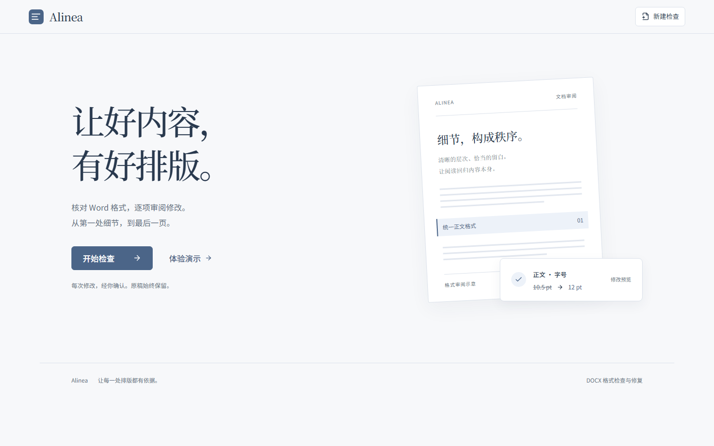
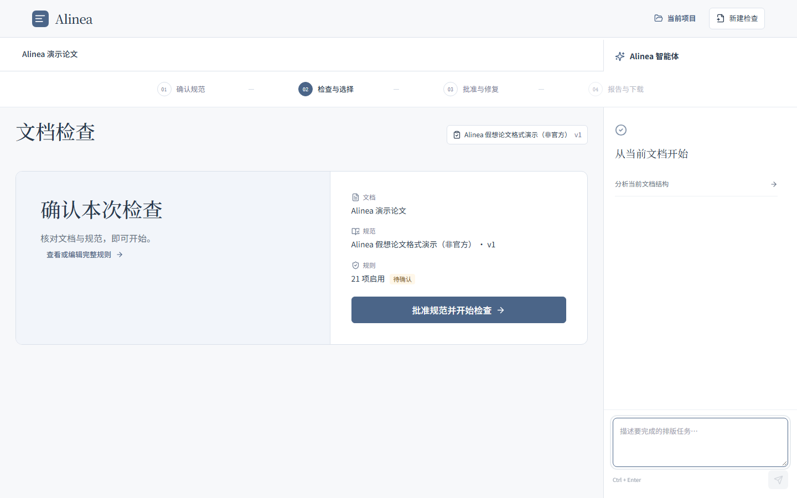
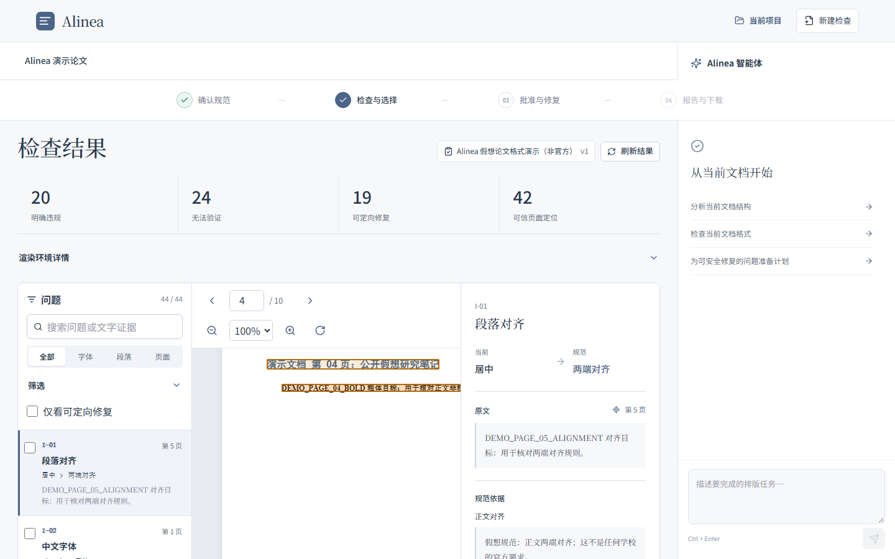
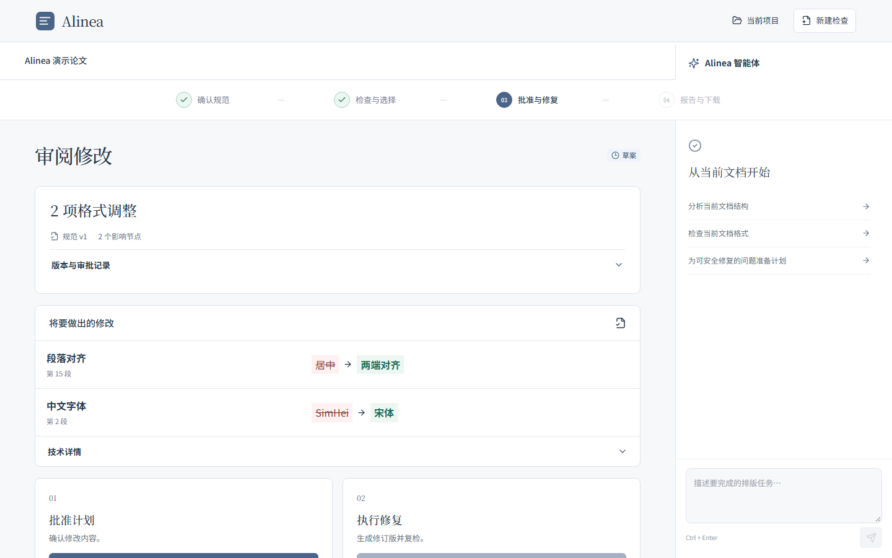
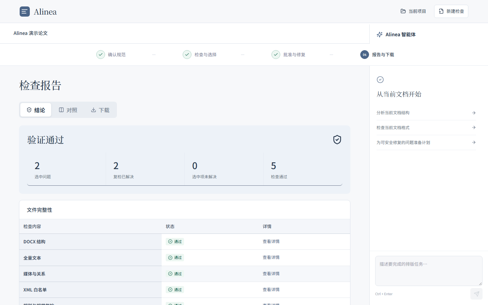
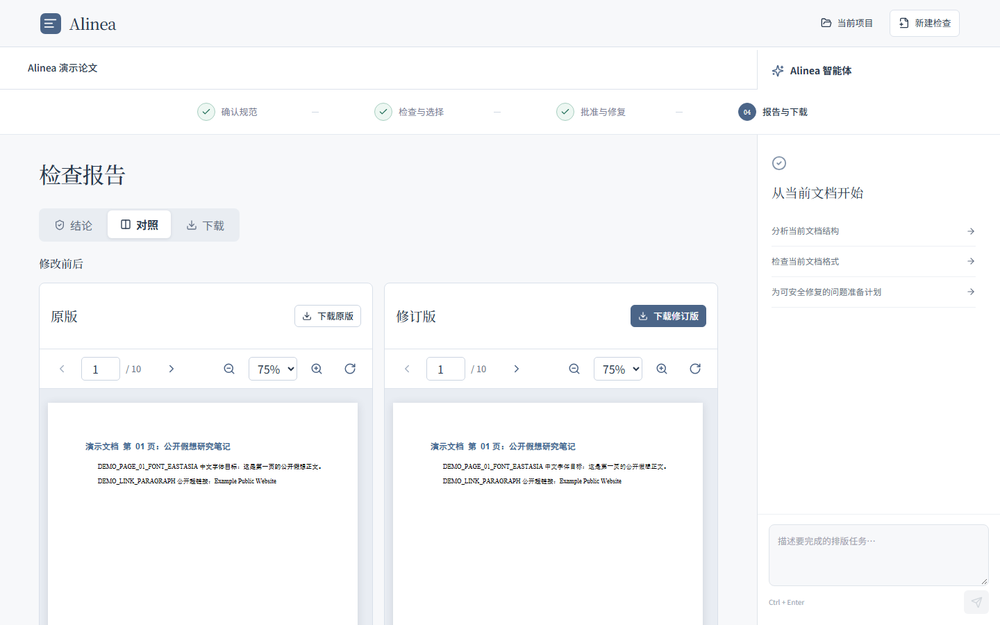
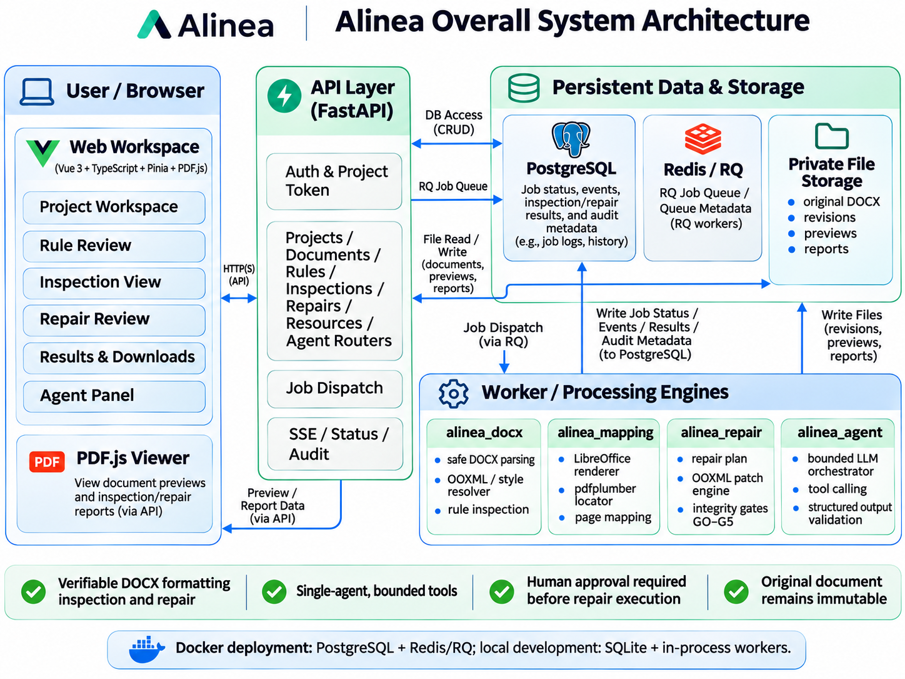
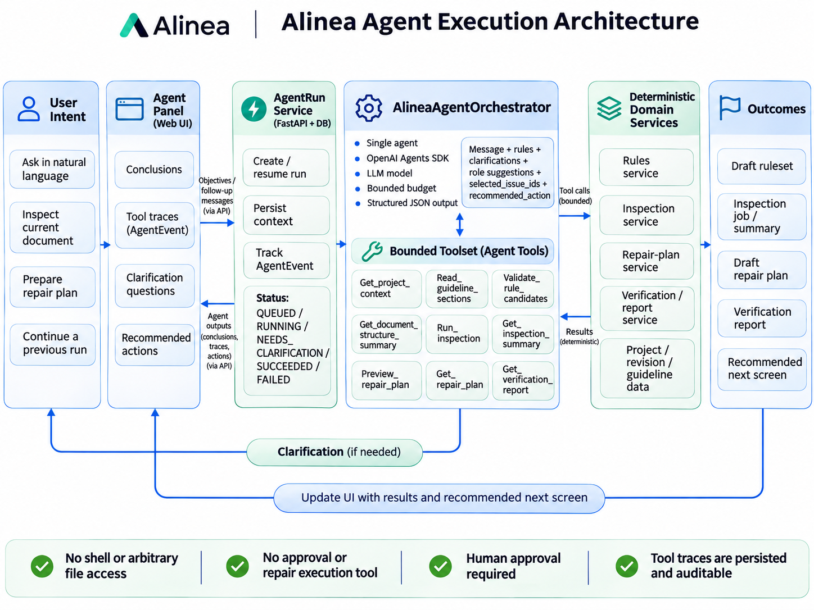
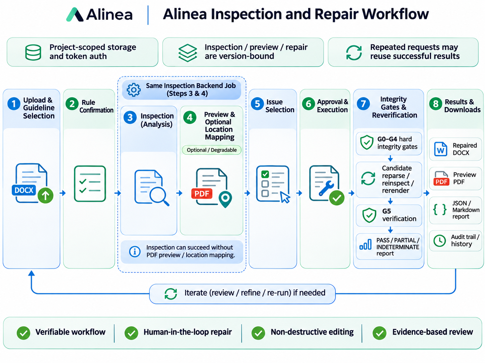

# Alinea

**Document Formatting, Made Verifiable. 让每一处排版都有依据。**

[](https://github.com/YiYun-ll/Alinea/actions/workflows/ci.yml)
[](LICENSE)
[](https://github.com/YiYun-ll/Alinea/issues)


Alinea 是一个可本地运行、可自托管的 DOCX 格式检查与修复系统。它结合**单 Agent 受限编排**与**确定性 WordprocessingML 检查引擎**，支持规范整理、问题证据定位、人工审批修复、完整性门禁和复检报告。

Agent 只负责理解任务和调用受限工具；文档解析、规则判定、OOXML 修补与质量门禁由确定性程序完成。原始 DOCX 始终保留，修复只在人工批准后写入副本。

[界面预览](#界面预览) · [核心功能](#核心功能) · [系统架构](#系统架构) · [快速开始](#快速开始) · [使用流程](#使用流程) · [测试与验收](#测试与验收) · [项目文档](#项目文档)

## 界面预览

以下截图来自本仓库的真实运行流程，使用 `examples/alinea-demo.docx` 和非官方演示预设完成检查、审批、修复与复检，并非设计稿或静态 mock。

<table>
  <tr>
    <td align="center"><strong>首页</strong></td>
    <td align="center"><strong>规范确认</strong></td>
  </tr>
  <tr>
    <td></td>
    <td></td>
  </tr>
  <tr>
    <td align="center"><strong>检查工作台与 PDF 问题定位</strong></td>
    <td align="center"><strong>修复计划审阅与人工批准</strong></td>
  </tr>
  <tr>
    <td></td>
    <td></td>
  </tr>
  <tr>
    <td align="center"><strong>完整性与复检报告</strong></td>
    <td align="center"><strong>原版与修订版对照</strong></td>
  </tr>
  <tr>
    <td></td>
    <td></td>
  </tr>
</table>

> 演示文档和 `general_report`、`thesis_demo` 预设仅用于软件测试，不代表任何学校或机构的官方格式要求。

## 核心功能

- **多来源规范**：支持内置预设、粘贴文本和文本型 PDF；候选规则需校验证据与冲突，并经人工批准。
- **确定性 DOCX 检查**：解析 WordprocessingML，计算样式继承与直接格式，区分明确违规、无法验证和可定向修复。
- **PDF 证据定位**：通过 LibreOffice 渲染、pdfplumber 文本锚定和 PDF.js 高亮展示问题；定位不可靠时明确降级，不绘制猜测框。
- **人工审批修复**：逐条查看 before → after、目标节点和 OOXML 白名单；批准计划与执行修复是两个独立操作。
- **G0–G5 质量门禁**：检查输入安全、DOCX 结构、全量文本、媒体与关系、XML 变更白名单及修复后复检。
- **版本与任务恢复**：检查、预览和修复绑定文档版本及规则摘要；支持幂等复用、失败重试、排队取消和本地任务恢复。
- **受限 Agent**：提供连续对话、澄清、工具轨迹和下一步导航；无 Shell、任意文件访问、审批或修复执行工具。
- **结果导出**：下载修订 DOCX、PDF 预览、JSON/Markdown 报告，并查看任务、版本和审计历史。

## 系统架构

### 总体架构

浏览器通过 FastAPI 访问项目资源；Docker 部署使用 PostgreSQL、Redis/RQ、独立 Worker 和私有文件存储。本地开发默认使用 SQLite 与进程内 Worker。



### Agent 执行架构

AgentRun 持久化运行上下文与 AgentEvent。单 Agent 在预算内调用 9 个项目级工具，输出经 JSON/Pydantic 校验；规则与修复审批仍由用户通过原有业务接口完成。



### 检查与修复流程

检查与页面定位属于同一后台任务。修复依次经过 G0–G4 硬门禁、候选文档重解析/复检/重渲染和 G5 验证；硬门禁失败时保留诊断报告，但不发布候选 DOCX。



## 技术栈

| 层级 | 技术 |
|---|---|
| Web | Vue 3、TypeScript、Pinia、Vue Router、PDF.js、Vite |
| API | Python 3.12、FastAPI、Pydantic、SQLAlchemy、SSE |
| 文档引擎 | python-docx、lxml、WordprocessingML、LibreOffice、pdfplumber |
| Agent | OpenAI Agents SDK、OpenAI 兼容模型端点、受限工具与结构化输出 |
| 任务与存储 | 本地 ThreadPoolExecutor 或 Redis/RQ；SQLite 或 PostgreSQL；私有文件存储 |
| 部署与质量 | Docker Compose、Pytest、Ruff、Vitest、Playwright、GitHub Actions |

## 快速开始

### 环境要求

- Python 3.12+
- Node.js 22+ 与 npm
- LibreOffice Writer：PDF 预览和页面定位需要；纯结构检查可降级运行
- 可选：Docker 与 Docker Compose

### 1. 获取项目

```bash
git clone https://github.com/YiYun-ll/Alinea.git
cd Alinea
```

### 2. 安装依赖

Windows PowerShell：

```powershell
py -3.12 -m venv .venv
.\.venv\Scripts\python.exe -m pip install -e ".[dev]"
npm ci --prefix apps/web
Copy-Item .env.example .env
```

macOS / Linux：

```bash
python3.12 -m venv .venv
.venv/bin/python -m pip install -e '.[dev]'
npm ci --prefix apps/web
cp .env.example .env
```

`.env` 保存本地配置和模型密钥，不应提交到版本库。未配置模型时，仍可使用预设、手动规则以及完整检查修复流程。

### 3. 配置运行环境

常用配置见 `.env.example`：

| 配置项 | 说明 |
|---|---|
| `ALINEA_DATABASE_URL` | 默认 `sqlite:///./.data/alinea.db`；Docker 使用 PostgreSQL |
| `ALINEA_STORAGE_ROOT` | 原稿、修订版、预览和报告的私有存储目录 |
| `ALINEA_REDIS_URL` | 留空使用本地 Worker；配置后使用 Redis/RQ |
| `ALINEA_SOFFICE_PATH` | LibreOffice 可执行文件路径；也会探测 `.tools/LibreOffice` 和系统安装 |
| `ALINEA_LLM_BASE_URL` / `ALINEA_LLM_MODEL` | OpenAI 兼容模型端点与模型名称 |
| `ALINEA_LLM_API_KEY` | 模型密钥；留空禁用模型调用 |
| `ALINEA_MAX_FILE_MB` / `ALINEA_MAX_PAGES` | 上传文件与渲染页数限制 |
| `ALINEA_PROJECT_TTL_HOURS` | 匿名项目保留时间，默认 24 小时 |

### 4. 启动服务

启动 API，工作目录必须是仓库根目录：

```bash
# Windows Git Bash
.venv/Scripts/python -m uvicorn app.main:app --app-dir apps/api --reload

# macOS / Linux
.venv/bin/python -m uvicorn app.main:app --app-dir apps/api --reload
```

另开终端启动 Web：

```bash
npm run dev --prefix apps/web
```

打开 <http://127.0.0.1:5173>。点击“体验演示”可创建真实演示工作区，也可以上传自己的 DOCX。

### Docker Compose

```bash
docker compose up --build
```

Compose 包含 Web、API、RQ Worker、PostgreSQL 和 Redis，Web 默认位于 <http://localhost:8080>。首次构建会安装较大的 LibreOffice 与 Noto CJK 依赖。

## 使用流程

1. **上传与规范确认**：上传 DOCX，选择预设、文本或 PDF 规范，检查规则证据与冲突后批准规则版本。
2. **检查与问题选择**：查看违规统计、原文证据和 PDF 定位，只勾选需要处理且支持安全修复的问题。
3. **计划批准与执行**：核对 before → after 和影响节点，先批准修复计划，再单独执行；原稿不被覆盖。
4. **复检与下载**：查看 G0–G5、未解决项和新增违规，对照原版与修订版，下载文档及 JSON/Markdown 报告。

项目右侧的 Agent 面板也可以协助分析文档、提交检查和准备计划，但不会代替用户批准或执行修复。

## 安全与隐私

- 原始 DOCX 不可变；不会用 HTML、全文替换或模型生成文档重建原稿。
- 修复绑定文档 SHA、规则摘要、检查结果、目标锚点和旧格式值；版本变化会使旧计划失效。
- 项目令牌仅在创建时返回，服务端只保存 SHA-256；嵌套资源、下载与 SSE 均执行项目级鉴权。
- 默认不向模型发送完整 DOCX，只发送必要规范片段和有上限的低置信段落摘录；Agents SDK tracing 已禁用。
- 上传、XML 解析、LibreOffice 转换和高风险对象均有安全限制。Track Changes、宏、OLE、加密、公式、复杂域和文本框等场景会拒绝自动修复或要求人工复核。
- 匿名项目默认 24 小时到期，后台每 15 分钟检查清理，也可主动删除。

详细威胁边界见 [SECURITY.md](docs/SECURITY.md)。处理敏感材料前，请同时审查模型服务商的数据策略和自托管部署配置。

## 支持范围

| 能力 | 当前版本 |
|---|---|
| 中/西字体、字号、粗体 | 检测；受支持普通对象可审批修复 |
| 对齐、倍数/固定行距、缩进、段前后 | 检测；受支持普通对象可审批修复 |
| 页边距、页面尺寸 | 检测；明确分节作用域后审批 |
| 样式继承 | 支持 docDefaults、段落/字符 basedOn 链与直接格式的子集 |
| 简单表格、超链接、图片 | 结构保留与完整性门禁；复杂布局定位可降级 |
| 重复或跨页文本 | 上下文消歧与多页片段；不可靠则不高亮 |
| Track Changes、OLE、宏、加密文件 | 拒绝或只读诊断，不自动修复 |
| 公式、复杂域、文本框、复杂合并表格 | 人工复核，不自动修复 |
| 扫描 PDF OCR、在线全文编辑、协作、账号/计费 | 不属于当前版本 |

LibreOffice 与 Microsoft Word 的字体替换、布局和分页可能不同。规则符合性与特定渲染环境的视觉结果分别报告；最终分页仍建议在 Microsoft Word 中复核。

## 项目结构

```text
Alinea/
├── apps/
│   ├── api/                 # FastAPI、REST/SSE、任务调度、持久化与领域服务
│   └── web/                 # Vue/Pinia 工作区、Agent 面板与 PDF.js 预览
├── packages/
│   ├── alinea_agent/        # 单 Agent 编排、预算与结构化输出
│   ├── alinea_contracts/    # 跨 API/Worker/引擎共享契约
│   ├── alinea_docx/         # 安全解析、样式解析、规则 DSL 与检查器
│   ├── alinea_mapping/      # LibreOffice 渲染与 PDF 定位
│   └── alinea_repair/       # 修复计划、OOXML 修补与 G0–G5
├── docs/                    # 架构、API、规则、安全与功能文档
│   └── assets/              # README 架构图与真实运行截图
├── examples/                # 可复现的虚构演示文档和规范
├── infra/                   # Dockerfile 与 Nginx 配置
├── scripts/                 # 基准、冒烟与 SBOM 工具
├── tests/                   # Python 单元测试与集成测试
└── docker-compose.yml       # PostgreSQL + Redis/RQ 自托管部署
```

## 测试与验收

Windows Git Bash 下运行完整检查：

```bash
.venv/Scripts/python -m pytest
.venv/Scripts/python -m ruff check .
npm run typecheck --prefix apps/web
npm run lint --prefix apps/web
npm run test --prefix apps/web
npm run build --prefix apps/web
PYTHON=.venv/Scripts/python npm run test:e2e --prefix apps/web
```

macOS / Linux 将 Python 路径替换为 `.venv/bin/python`。CI 使用相同的主要检查，并安装 LibreOffice、Noto CJK 和 Playwright Chromium，见 [ci.yml](.github/workflows/ci.yml)。

重新生成合成/脱敏测试夹具与演示文件：

```bash
.venv/Scripts/python tests/fixtures/generate_fixtures.py
```

真实 LibreOffice 冒烟和依赖许可证清单：

```bash
ALINEA_RUN_LO_SMOKE=1 .venv/Scripts/python -m pytest -q tests/unit/alinea_mapping/test_real_renderer_smoke.py
.venv/Scripts/python scripts/generate_sbom.py
```

实测指标与运行环境见 `reports/`。目标值不得当作实测结果。`mypy` 目前仍有未解决的类型错误，因此不列为已通过的验收项。

## 项目文档

| 文档 | 内容 |
|---|---|
| [ARCHITECTURE.md](docs/ARCHITECTURE.md) | 模块、数据流、缓存与版本一致性 |
| [API.md](docs/API.md) | REST/SSE 契约、幂等、任务恢复与 AgentRun |
| [RULE_DSL.md](docs/RULE_DSL.md) | 原子规则、属性、单位与证据要求 |
| [SECURITY.md](docs/SECURITY.md) | 不可信输入、授权、隐私和部署安全 |
| [SUPPORTED_FEATURES.md](docs/SUPPORTED_FEATURES.md) | 功能支持与已知限制 |
| [BENCHMARK.md](docs/BENCHMARK.md) | 评测集与指标口径 |
| [examples/README.md](examples/README.md) | 演示数据、受控目标与使用边界 |
| [reports/SBOM.json](reports/SBOM.json) | 实际安装依赖与许可证清单 |

## 项目状态与贡献

Alinea 处于早期活跃开发阶段，接口、规则 DSL 和支持范围仍可能调整，使用前请查阅文档并验证目标文档类型。

欢迎通过 [Bug 报告](https://github.com/YiYun-ll/Alinea/issues/new?template=bug_report.yml)、[功能建议](https://github.com/YiYun-ll/Alinea/issues/new?template=feature_request.yml) 和 Pull Request 参与贡献。开发环境、验证要求与提交流程见 [CONTRIBUTING.md](CONTRIBUTING.md)，社区参与规范见 [CODE_OF_CONDUCT.md](CODE_OF_CONDUCT.md)。安全漏洞请按照 [SECURITY.md](SECURITY.md) 私密报告。

## 许可证

本项目采用 [Apache License 2.0](LICENSE)。你可以使用、修改、分发和商用本项目，但需保留版权与许可证声明，并标明对源文件所做的修改；许可证同时包含明确的专利授权及责任限制条款。

第三方依赖、字体、LibreOffice 和演示材料仍适用各自许可证。依赖清单见 [SBOM](reports/SBOM.json)，分发时不要将第三方许可证替换为本项目许可证。
